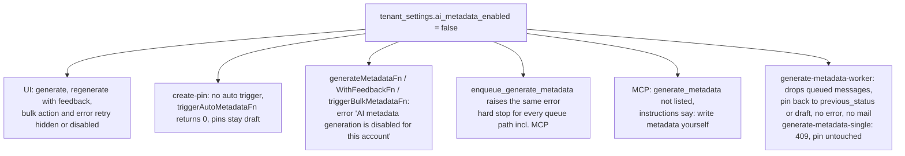
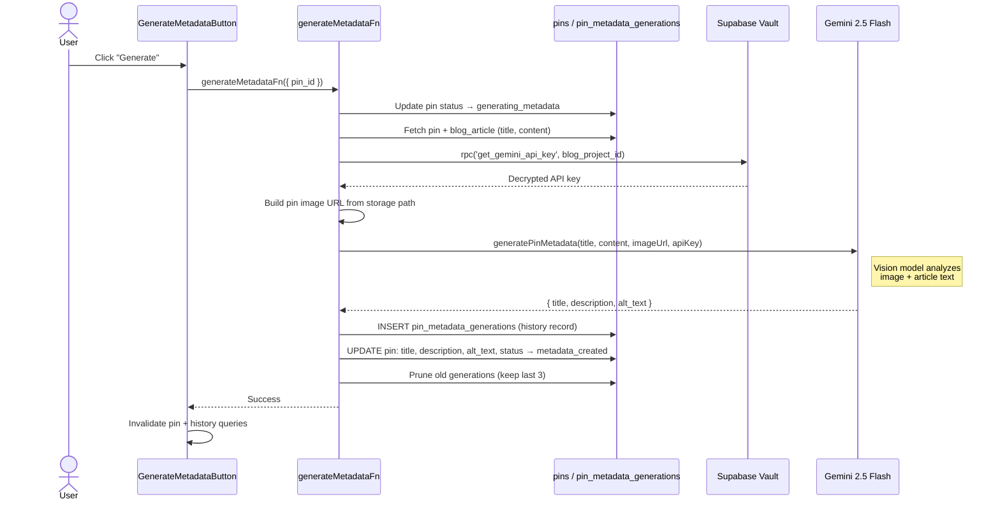
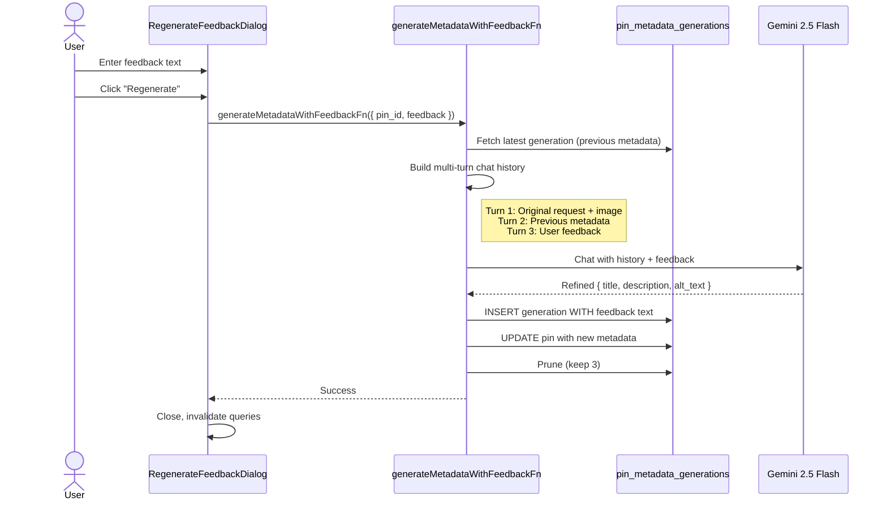
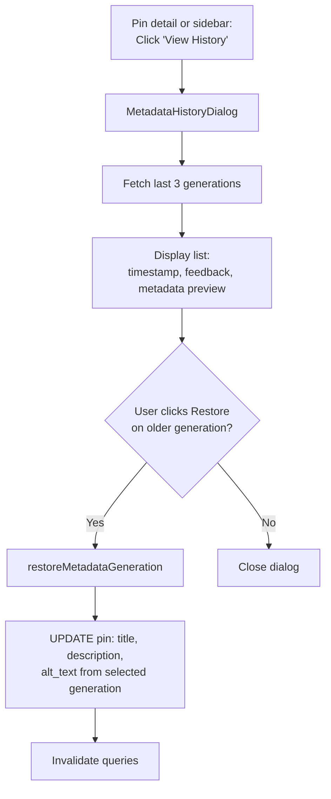
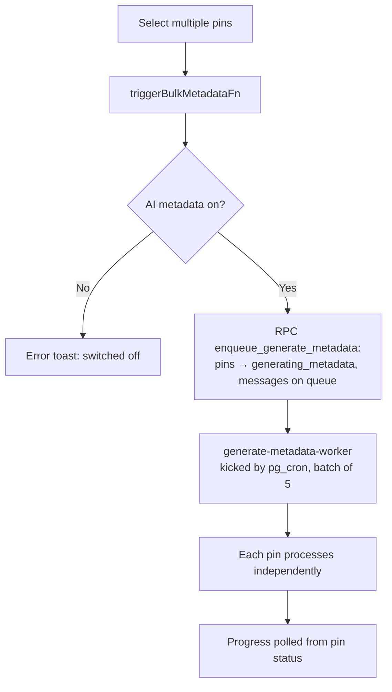

# AI Metadata Generation Flow

Generate pin titles, descriptions, and alt text using Gemini 2.5 Flash with vision. Supports initial generation, regeneration with user feedback, and history with restore.

**Prerequisites:**
- The account setting "KI-Metadaten automatisch erzeugen (Gemini)" is on (default). See [Account setting](#account-setting-ai-metadata-on--off).
- The project has a Gemini API key stored in Supabase Vault. See [Gemini API Key](gemini-api-key.md).

## Account setting: AI metadata on / off

Users switch automatic AI metadata generation for their whole account in `/settings` (ADR-0009). Stored in `tenant_settings.ai_metadata_enabled` (migration `00042_tenant_settings.sql`); no row means on. When off, the user writes titles and descriptions himself or lets a Connected Agent fill them in via MCP (`create_pin`, `create_pin_from_chat_image`, `set_pin_metadata`). No Gemini costs arise.

Where the setting is checked:

| Layer | Check | When off |
|-------|-------|----------|
| UI | `useAiMetadataEnabled()` (`src/lib/hooks/use-tenant-settings.ts`) | Actions hidden/disabled with a hint; no auto trigger after pin creation |
| Server functions | `readAiMetadataEnabled()` in `src/lib/server/metadata.ts` | Error; `triggerAutoMetadataFn` returns `pins_queued: 0` silently |
| Database | `enqueue_generate_metadata` | `RAISE EXCEPTION 'AI metadata generation is disabled for this account'` |
| Edge Functions | `_shared/pin-metadata.ts` throws `AiMetadataDisabledError` before any Gemini work | Worker: release pin, delete message. Single: HTTP 409, no error status |
| MCP | `ctx.aiMetadataEnabled`, `requiresAiMetadata` on `generate_metadata` | Tool not listed or callable; write tools and instructions say metadata is written by the agent |

Missing table (migration not applied) and missing row both count as on. Any other read error fails the server function or retries the queue message instead of calling Gemini on a guess.

## Generate Metadata

**Gemini prompt guidelines:**
- Title: max 100 characters, Pinterest SEO optimized
- Description: 220-232 characters with call-to-action
- Alt text: max 125 characters, accessibility-focused
- Article content truncated to 4000 characters

## Regenerate with Feedback

The feedback flow uses Gemini's multi-turn chat to replay the original generation context and apply the user's refinement instructions.

## View History & Restore

Each generation record shows:
- Timestamp
- "Current" badge (if most recent)
- Feedback text (if regenerated with feedback)
- Truncated title, description, alt_text preview
- Restore button (for non-current generations)

## Bulk Metadata Generation

For generating metadata across multiple pins at once:

The worker runs the same pipeline as the single-pin Edge Function (`_shared/pin-metadata.ts`), asynchronously (ADR-0004). New pins created in the UI are enqueued the same way by `triggerAutoMetadataFn`, unless AI metadata is off.

## Button States

The `GenerateMetadataButton` adapts its UI based on pin state:

| State | UI |
|-------|----|
| No metadata generated | "Generate" button |
| `status === 'generating_metadata'` | Spinner + "Generating..." (all buttons disabled) |
| Has metadata | "Regenerate" + "View History" + "Regenerate with Feedback" |

## Key Files

| File | Purpose |
|------|---------|
| `src/components/pins/generate-metadata-button.tsx` | Context-aware button with generate/regenerate actions |
| `src/components/pins/metadata-history-dialog.tsx` | History list with restore capability |
| `src/components/pins/regenerate-feedback-dialog.tsx` | Feedback textarea + regenerate action |
| `src/lib/server/metadata.ts` | Server functions: generate, feedback, bulk trigger |
| `src/lib/gemini/client.ts` | Gemini API: `generatePinMetadata`, `generatePinMetadataWithFeedback` |
| `src/lib/api/metadata.ts` | Client API: `getMetadataHistory`, `restoreMetadataGeneration` |
| `src/lib/hooks/use-metadata.ts` | TanStack Query hooks for all metadata operations |
| `src/lib/ai-metadata-setting.ts` | Reads the account setting (missing row/table = on), shared error text |
| `src/lib/hooks/use-tenant-settings.ts` | `useAiMetadataEnabled`, `useSetAiMetadataEnabled` |
| `src/components/settings/ai-metadata-setting.tsx` | Switch in `/settings` |
| `supabase/functions/_shared/ai-metadata-setting.ts` | Edge-side check and pin release |
