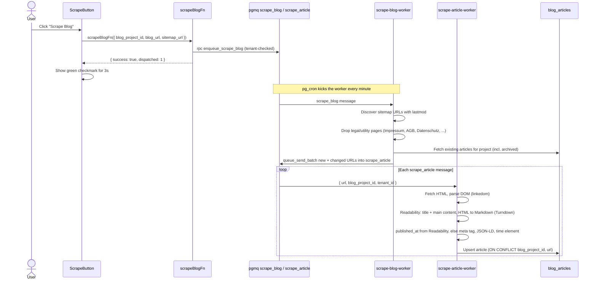
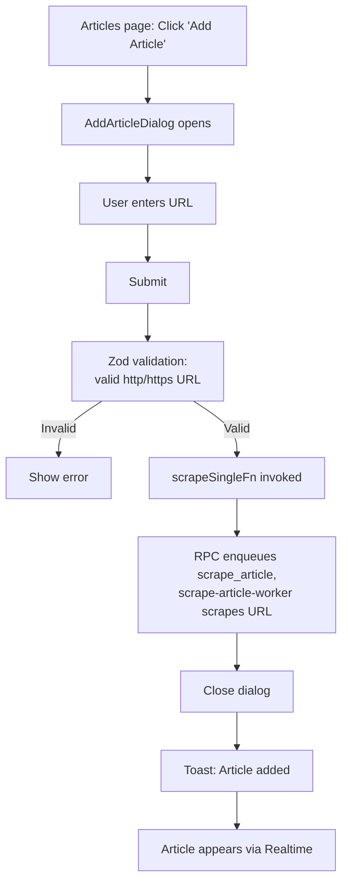
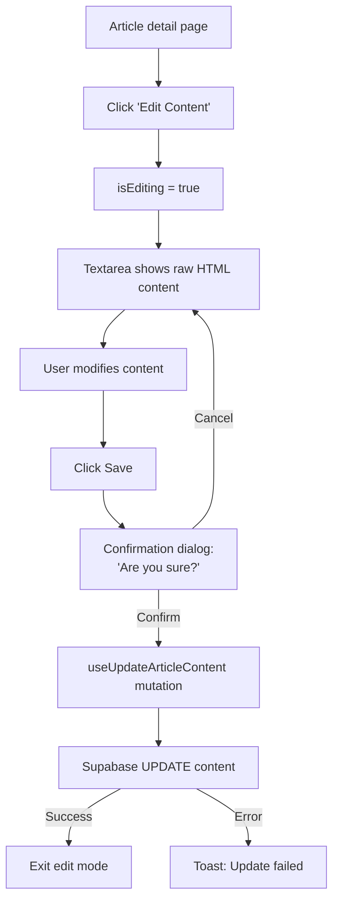
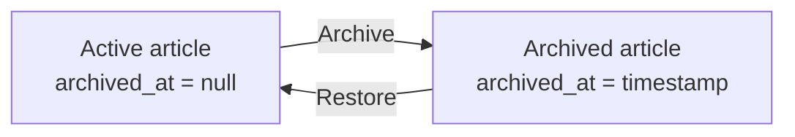

# Article Management Flow

Blog scraping, manual article addition, content editing, and archive/restore. Articles are scraped from blog sitemaps, extracted with Mozilla Readability (no AI, no Gemini key needed, ADR-0008) and stored for linking to pins.

## Bulk Scrape

The server function returns immediately after enqueueing (fire-and-forget). New articles appear via Supabase Realtime subscription on the articles table.

### Article extraction

`supabase/functions/_shared/extract-article.ts` runs per article, without AI and without the project's Gemini key (ADR-0008):

- **DOM:** `npm:linkedom` (the Edge runtime has no `DOMParser`). A `<base>` with the article URL is injected so relative links become absolute.
- **Content:** `npm:@mozilla/readability` picks the main content and drops navigation, sidebar, footer and cookie banners. `npm:turndown` converts it to Markdown; headings, lists, links and emphasis stay, images, figures, embeds and forms are dropped.
- **Title:** Readability's title; if the page has exactly one `<h1>` contained in that title, the `<h1>` wins (strips the " - Blog name" suffix).
- **Date:** Readability `publishedTime`, else `article:published_time` and similar meta tags, else JSON-LD `datePublished` (also inside `@graph`), else the first `<time datetime>`. `parsePublishedAt` turns it into ISO or `null`.
- **No article:** if Readability returns nothing or under 250 characters of text, `NoArticleFoundError` is thrown and nothing is upserted. The queue retries and mails after the last attempt like any other failure.

### Skipped sitemap URLs

`supabase/functions/_shared/url-filter.ts` drops legal and utility pages before the diff: Impressum, Datenschutz/Privacy, AGB/Terms, Widerruf, Cookie pages, Kontakt, Warenkorb/Checkout/Mein Konto, Versand, newsletter confirmation and thank-you pages. Many sites stamp these with the build time as `lastmod`, so without the filter they came back as "updated" on every scan, Readability found no article, and each one ended in an error mail. Only the last segment of paths with at most two segments is matched (`/impressum`, `/de/impressum`), so article slugs like `/datenschutz-fuer-blogger` stay in. Taxonomy and product pages (`/tag/`, `/category/`, `/produkt-kategorie/`, `/products/`) are not filtered because some pins link to them. Already stored legal pages remain in `blog_articles`; they are simply no longer re-scraped.

> **Note:** The duplicate check queries all articles for the project **including archived ones** (no `archived_at` filter). This ensures archived articles are not re-scraped. If an archived article's `lastmod` in the sitemap is newer than its `scraped_at`, it will be re-scraped and updated in place — but it remains archived.

## Manual Add

## Content Editing

Content is rendered via `sanitizeHtml()` + `dangerouslySetInnerHTML` in view mode. The textarea uses monospace font for HTML editing.

## Archive / Restore

Articles use soft deletion via the `archived_at` timestamp column:

- **Archive:** Sets `archived_at = NOW()`, article hidden from active list
- **Restore:** Sets `archived_at = null`, article returns to active list
- Articles are never hard-deleted
- **Pin creation:** Archived articles are excluded from the article selector (uses `archived_at IS NULL` filter)
- **Existing pins:** Pins linked to an archived article keep their reference — the article link on the pin detail page still works

The articles table has two tabs: "Active" (default) and "Archived". Both show title, date, pin count, source URL, and an action button (Archive or Restore).

## Articles Table Features

- **Sortable columns:** title, published_at, pin_count (derived), URL domain
- **Pin count badges:** Aggregated from the pins table per article
- **Realtime updates:** Listens for INSERT events to auto-refresh when scraping completes
- **Link to detail:** Clicking an article title navigates to the detail page

## Article Detail Page

Displays article metadata, content, and linked pins:

- **Metadata:** Published date, scraped date, pin count
- **Linked pins:** Up to 5 pins shown with "Load More" pagination
- **Content:** Sanitized HTML rendering with edit toggle
- **Actions:** Edit content, view original (external link), archive/restore

## Key Files

| File | Purpose |
|------|---------|
| `src/components/articles/scrape-button.tsx` | Bulk scrape trigger with loading/success/error states |
| `src/components/articles/add-article-dialog.tsx` | Manual URL input with Zod validation |
| `src/components/articles/articles-table.tsx` | Sortable table with active/archived tabs |
| `src/routes/_authed/projects/$projectId/articles/index.tsx` | Articles list page |
| `src/routes/_authed/projects/$projectId/articles/$articleId.tsx` | Article detail with content editing |
| `src/lib/server/scraping.ts` | Server functions: `scrapeBlogFn`, `scrapeSingleFn` |
| `supabase/functions/_shared/scrape-blog.ts` | Sitemap discovery + fan-out into `scrape_article` |
| `supabase/functions/_shared/scrape-article.ts` | Single-article scrape pipeline |
| `supabase/functions/_shared/extract-article.ts` | Readability extraction: title, Markdown content, published_at |
| `src/lib/api/articles.ts` | API: CRUD, archive/restore, content update |
| `src/lib/hooks/use-articles.ts` | TanStack Query hooks with realtime invalidation |
