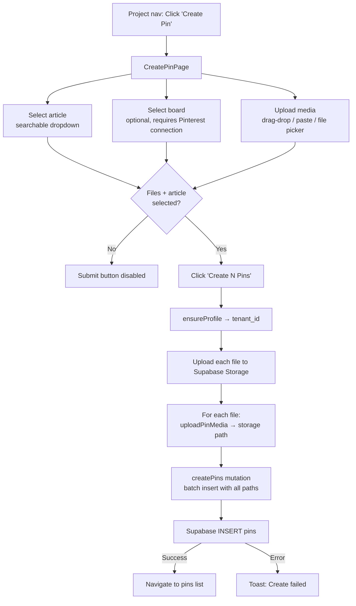

# Pin Creation Flow

Creating new pins with media upload. Each pin is linked to an article and optionally assigned to a Pinterest board. Multiple pins can be created at once from different media files.

## Create Pins



## Media Upload Details

The `MediaUploadZone` component supports multiple input methods:

| Method | Description |
|--------|-------------|
| Click | Opens file picker dialog |
| Drag & drop | Drop files onto the zone |
| Clipboard paste | Paste images from clipboard |

**Accepted types:** `image/*`, `video/mp4`, `video/quicktime`, `video/webm`

**Per-file features:**
- Thumbnail preview (video seeks to 0.5s for thumbnail)
- Dimensions display with aspect ratio warning if not ~2:3 portrait (0.6-0.7 ratio)
- File size display (formatted as B/KB/MB)
- "VIDEO" badge for video files
- Individual remove button

**Storage path format:** `{tenant_id}/{uuid}.{extension}` in the `pin-images` bucket.

## Pin Insert Data

Each pin in the batch is created with:

```typescript
{
  blog_project_id: string    // From route params
  blog_article_id: string    // Selected article
  image_path: string         // Storage path from upload
  media_type: 'image' | 'video'  // Detected from MIME type
  pinterest_board_id?: string    // Optional board selection
  pinterest_board_name?: string  // Board display name
}
```

Pins are created with `status: 'draft'` by default. The `tenant_id` is added by the API function.

## Board Selection

- Board dropdown is disabled if Pinterest is not connected to the project
- Shows a warning alert if no connection exists
- Shows "No boards available" if connected but no boards found
- Board selection applies to all pins in the batch

## Via MCP (Connected Agent)

A Connected Agent creates pins with the MCP tool `create_pin`
(`src/lib/mcp/tools/pins-write.ts`). It never triggers Gemini (ADR-0006): the
pin is `metadata_created` when Titel, Beschreibung and Board are given, else
`draft`. The image comes from exactly one of two sources:

- **`image_url`** - a public HTTPS URL. Pinfinity downloads it (`image/*`, max 20 MB).
- **`upload_path`** - for images without a public URL (local files, images the
  agent generated). Two steps (#135):
  1. `request_pin_upload(content_type)` returns `upload_url` (signed, valid
     about 2 hours), `upload_path` (`{tenant_id}/{uuid}.{ext}`) and a
     `curl_example`.
  2. The agent PUTs the bytes itself, then calls `create_pin(upload_path)`:
     ```bash
     curl -X PUT -H "Content-Type: image/png" --data-binary @pin.png "<upload_url>"
     ```
  `create_pin` rejects a path outside the caller's tenant folder, a missing
  object, a non-image or an object over 20 MB (both deleted), and a path that
  already backs a pin.

If an upload is reserved but `create_pin` is never called (agent aborts, UI
upload followed by a failed insert), the object is left orphaned in
`pin-images`. The daily `cleanup-published-images` Edge Function removes
orphaned uploads older than 7 days — objects no pin references via `image_path`
or `cover_image_path` — using the service-role-only RPC
`list_orphaned_pin_images()` (max 100 per run, #138). The 7-day buffer safely
covers the ~2-hour signed upload URL and in-progress Werkstatt sessions.

Cowork: the sandbox must be allowed to reach `dedacaqstvzxlxpxvxgb.supabase.co`
(network allowlist in the Cowork settings), otherwise the PUT fails. ChatGPT's
code interpreter has no network and cannot use this path.

## Key Files

| File | Purpose |
|------|---------|
| `src/routes/_authed/projects/$projectId/create-pin.tsx` | Create pin page with article/board/media selection |
| `src/components/pins/media-upload-zone.tsx` | Multi-file upload with drag-drop, paste, preview |
| `src/lib/api/pins.ts` | `uploadPinMedia`, `createPins` functions |
| `src/lib/hooks/use-pins.ts` | `useCreatePins` mutation hook |
| `src/types/pins.ts` | `Pin`, `PinInsert` type definitions |
| `src/lib/mcp/tools/pins-write.ts` | MCP `request_pin_upload`, `create_pin` |
