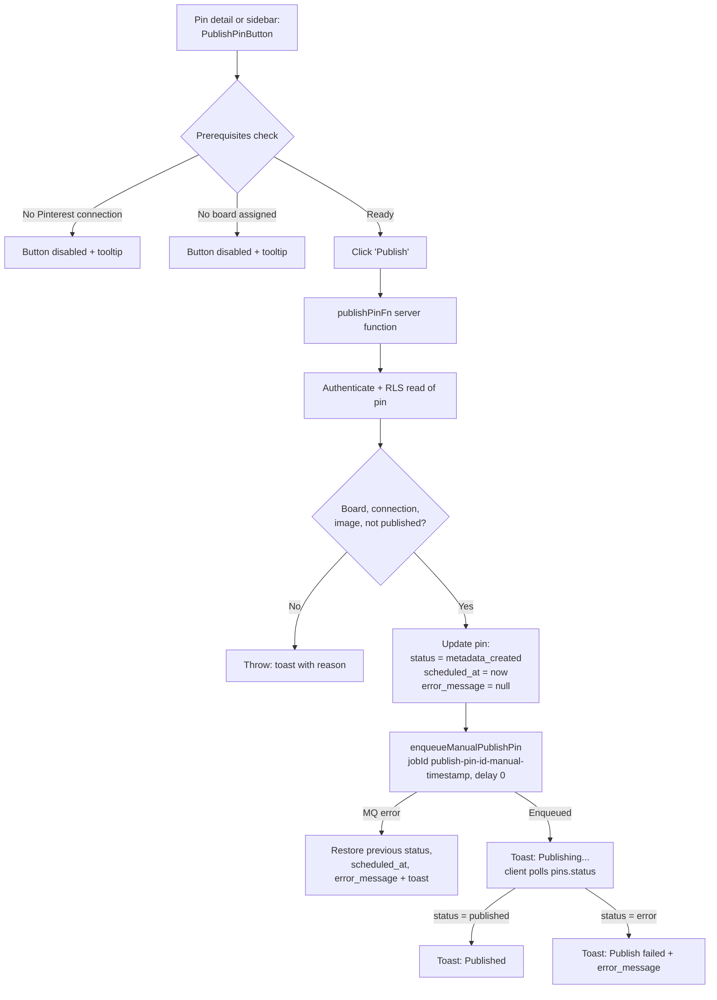
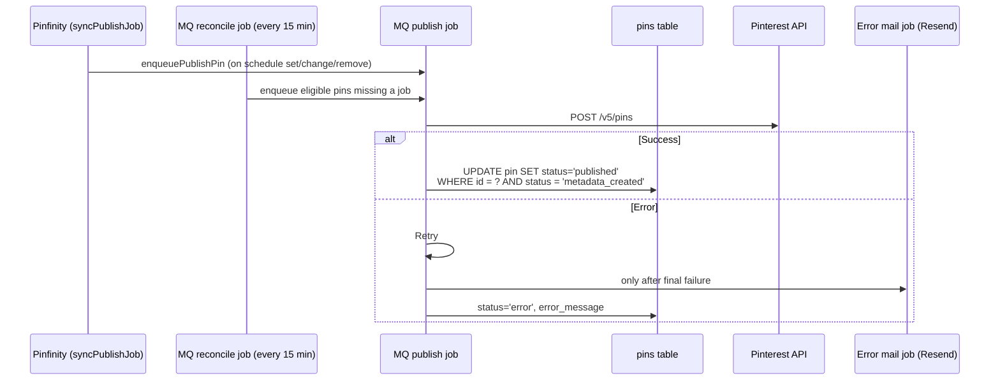
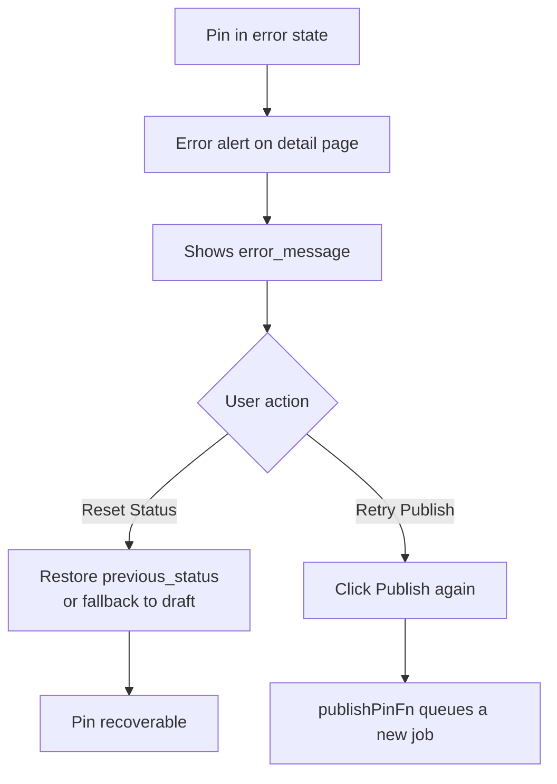
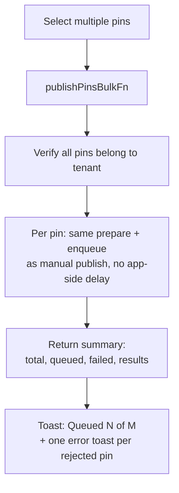

# Pin Publishing Flow

Manual publish via the UI, automatic publish via MQ, and error recovery. Publishing creates a pin on Pinterest via the v5 API.

For the full pin status state machine, see [Pin Status Flow](../pin-status-flow.md).

## Manual Publish

Manual publish goes through the MQ like scheduled publish (issue #106, Variant B). The click only queues an immediate job; the MQ worker publishes, retries (429, 5xx, network) and sends the error mail after the final failure.



- The pin is prepared as a regular publish candidate because the worker checks `status = metadata_created`, `scheduled_at` set and its stale guard compares `scheduled_at`. A pending scheduled job for the same pin becomes stale and is skipped.
- The unique `-manual-<timestamp>` jobId keeps the manual job from replacing the scheduled one.
- There is no intermediate `publishing` status. While the job waits (including retry backoff of up to ~35 min), the pin shows `metadata_created`; the hook polls every 5 s for up to 40 min.
- Error mail applies to manual publishes too (after the final failure).

## Auto-Publish (Scheduled, via MQ)

Since the cutover (issue #107, ADR-0005) scheduled pins are published by MQ (weissteiner-automation-mq), not by pg_cron. The pg_cron job `publish-scheduled-pins` is deactivated (`cron.alter_job(4, active := false)`, reversible).



- **Eligible pin:** `status = metadata_created`, `scheduled_at` set, `pinterest_pin_id` empty, project has Pinterest connection and board.
- **Retry:** MQ retries failed publishes; retries are visible on the MQ board.
- **Error mail:** sent only after the last retry failed (final failure), as a follow-up job. No mail per attempt.
- **Atomic update:** `status = 'metadata_created'` in the WHERE clause prevents double-publishing. The check runs after the Pinterest call, so the old cron and MQ must never run in parallel (hence cron off before reconcile).
- **Fallback:** the Edge Function `publish-scheduled-pins` stays deployed for a few clean days, then it is removed together with its `notifyPinError` calls and the cron job (migration).

## Enqueueing after AI metadata generation (MQ)

Decision (issue #105): **Variant B**. The Edge Functions `generate-metadata-single` and `generate-metadata-worker` do **not** call MQ when a pin reaches `metadata_created`. A pin that already has a `scheduled_at` is picked up by the MQ reconcile job (every 15 min).

- Delay: up to 15 min until enqueued. Irrelevant for future schedules, a short lateness for schedules in the past.
- The other Edge Functions are expected to migrate to MQ soon as well.
- Revisit Variant A (Deno MQ client in `supabase/functions/_shared/`, secrets `MQ_API_URL` and `MQ_API_KEY`) only if the delay becomes a problem.

## Error Recovery



When a publish fails:
- `status` is set to `error`
- `error_message` stores the failure reason
- `previous_status` preserves the pre-error status for recovery
- User can reset status and retry, or fix the issue first (e.g., reconnect Pinterest)

## Bulk Publishing



The 10 s spacing per Pinterest connection is enforced by the MQ worker.

## Pinterest API Payload

The pin is published with:

```
{
  board_id:     pin.pinterest_board_id
  title:        pin.title (max 100 chars)
  description:  pin.description (max 800 chars)
  alt_text:     pin.alt_text (max 500 chars)
  link:         article.url (blog post link)
  media_source: {
    source_type: 'image_url'
    url:         public Supabase Storage URL
  }
}
```

## Publish Button States

| Pin State | Button UI |
|-----------|-----------|
| `published` with URL | Green badge + external link to Pinterest |
| `published` without URL | Green "Published" badge |
| `error` | Red retry button with rotation icon |
| No Pinterest connection | Disabled + "Connect Pinterest first" tooltip |
| No board assigned | Disabled + "Assign a board first" tooltip |
| Ready to publish | Active "Publish" button |

## Key Files

| File | Purpose |
|------|---------|
| `src/components/pins/publish-pin-button.tsx` | Publish button with prerequisite checks |
| `src/lib/server/pinterest-publishing.ts` | Server functions `publishPinFn`, `publishPinsBulkFn` (queue via MQ) |
| `src/lib/server/mq.ts` | MQ client: `enqueuePublishPin`, `enqueueManualPublishPin`, `cancelPublishPin` |
| `src/lib/server/pinterest-api.ts` | `createPinterestPin` with exponential backoff retry |
| `src/lib/hooks/use-pinterest-publishing.ts` | `usePublishPin`, `usePublishPinsBulk` hooks (incl. status polling) |
| `supabase/functions/publish-scheduled-pins/index.ts` | Legacy auto-publish Edge Function (cron deactivated, fallback until removal) |
